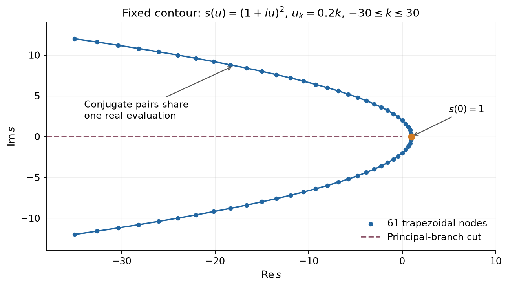
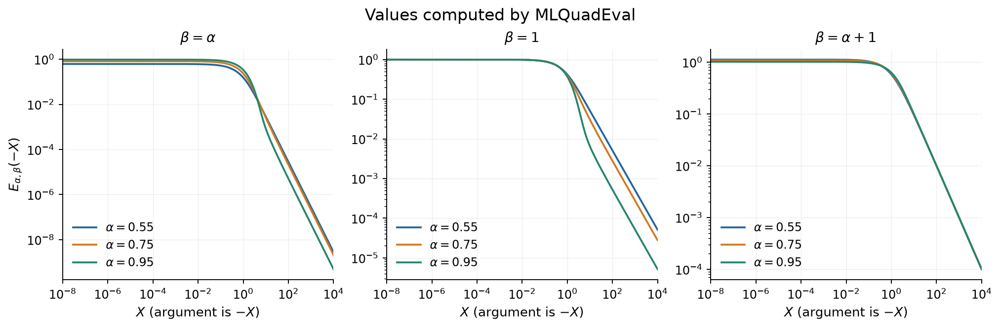
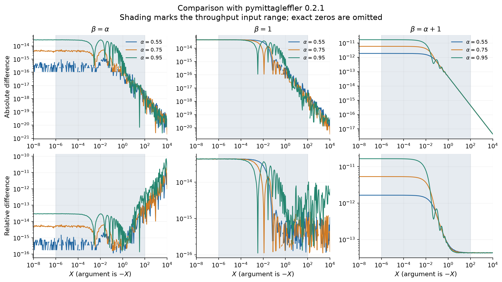
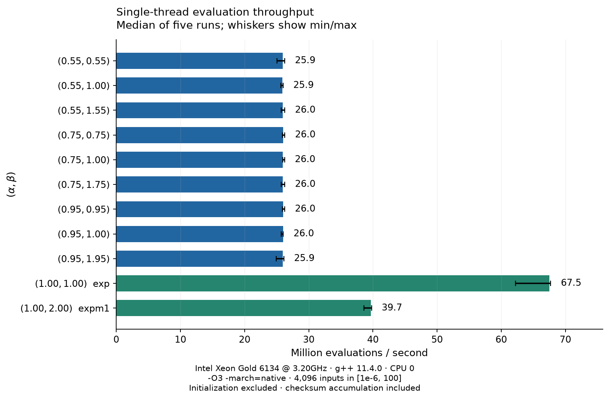

# Mittag-Leffler on the negative real axis

An efficient double-precision implementation of the two-parameter Mittag-Leffler function for the specific case

$$
E_{\alpha,\beta}(-X),\qquad X\geq 0,
$$

designed for evaluating many arguments with the same real parameters $\alpha,\beta$. The usual one-parameter function is $E_\alpha(-X)=E_{\alpha,1}(-X)$.

The implementation precomputes a fixed parabolic-contour quadrature. Each subsequent general evaluation uses **31 real rational terms**, with no complex arithmetic, transcendental functions, or heap allocation. The benchmark below measures approximately **26 million evaluations per second** on one Xeon Gold 6134 hardware thread, excluding setup.

## Usage and scope

**Pass the nonnegative magnitude `X`.** `MLQuadEval(2.0, &Q)` approximates $E_{\alpha,\beta}(-2)$.

```cpp
#include <complex.h>
#include <stdio.h>
#include "src/mittag_leffler.h"
#include "src/mittag_leffler.cpp"

int main()
{
    MLQuad Q;
    MLQuadInit(0.75, 1.0, &Q);
    double Value = MLQuadEval(2.0, &Q);
    printf("%.17g\n", Value);
}
```

This is not a standalone library. The code is meant to be copied or ported into your own project, adapting the types, naming conventions, and build setup to your codebase. Initialize once for each parameter pair and reuse `Q`; evaluation only reads the initialized coefficients.

The intended general regime is $0<\alpha<1$ with positive real $\beta$. The numerical checks below cover $\alpha\in\{0.55,0.75,0.95\}$ and $\beta\in\{\alpha,1,\alpha+1\}$, plus selected special cases. `MLQuadInit` does not validate the parameter domain, and these checks do not establish accuracy for every possible parameter pair.

| Input or parameter case | Behavior |
| :--- | :--- |
| Finite `X > 0` | Fixed quadrature, except for the two shortcuts below |
| `X == 0` | $1/\Gamma(\beta)$, cached during initialization |
| `X < 0`, NaN, or infinity | Returns `NAN` |
| $(\alpha,\beta)=(1,1)$ | `exp(-X)` |
| $(\alpha,\beta)=(1,2)$ | `-expm1(-X)/X` for `X > 0` |

The interface accepts real inputs and returns real values. Complex arguments and positive Mittag-Leffler arguments are outside its scope. The only $\alpha=1$ cases validated here are the two elementary shortcuts.

## Where the method comes from

This is **numerical inversion of a Laplace transform using trapezoidal quadrature on a parabolic contour**. Weideman and Trefethen [1] analyze this contour family for Bromwich integrals. Garrappa and Popolizio [2] specialize parabolic-contour methods to Mittag-Leffler functions on the real line. McLean [4], especially Sections 3.1 and 4, gives a close mathematical match to the fixed-contour formula and conjugate-symmetry reduction used here.

Garrappa's optimal parabolic contour algorithm [3] selects contour and quadrature parameters from an error analysis. The present implementation fixes the contour, spacing, and node count, then reuses its coefficients. The constants `h = 0.2` and `K = 30` are this implementation's settings; they are not an adaptive tolerance guarantee.

The [alexfikl/mittagleffler](https://github.com/alexfikl/mittagleffler) library [5] implements Garrappa's algorithm and supplies the Python reference used below. It is a validation dependency; the C++ evaluator has no dependency on that library.

## Computation

The defining series is

$$
E_{\alpha,\beta}(z)=\sum_{n=0}^{\infty}\frac{z^n}{\Gamma(\alpha n+\beta)}.
$$

Instead of summing this alternating series at $z=-X$, the implementation discretizes the contour representation [1, 4]

$$
E_{\alpha,\beta}(-X)
=\frac{1}{2\pi i}\int_{\mathcal C}
\frac{e^s s^{\alpha-\beta}}{s^\alpha+X}\,ds.
$$

Powers use the principal branch, with its cut on the negative real axis. For $0<\alpha<1$ and $X>0$, the denominator has no zeros in the cut plane. Choose

$$
s(u)=(1+iu)^2,\qquad -\infty<u<\infty.
$$

Since $ds=2i(1+iu)\,du$, this becomes

$$
E_{\alpha,\beta}(-X)
=\int_{-\infty}^{\infty}
\frac{e^{(1+iu)^2}(1+iu)^{2(\alpha-\beta)+1}}
{\pi\bigl((1+iu)^{2\alpha}+X\bigr)}\,du.
$$

The exponential has magnitude $e^{1-u^2}$. Apply the trapezoidal rule with $u_k=kh$, $h=0.2$, and truncate at $k=\pm30$, or $u=\pm6$. Conjugate symmetry pairs the positive and negative nodes, leaving 31 stored coefficient sets.



For $k=0,\ldots,30$, `MLQuadInit` computes

$$
w_k=1+ikh,\qquad
A_k+iB_k=\frac{e^{w_k^2}w_k^{2(\alpha-\beta)+1}}{\pi},\qquad
C_k+iD_k=w_k^{2\alpha}.
$$

`MLQuadEval` then evaluates the following real expression directly:

$$
E_{\alpha,\beta}(-X)\approx h\left[
\frac{A_0}{C_0+X}
+2\sum_{k=1}^{30}
\frac{A_k(C_k+X)+B_kD_k}{(C_k+X)^2+D_k^2}
\right].
$$

This explains the four arrays in `MLQuad`. The structure contains 127 doubles, or 1,016 bytes with eight-byte doubles. Expensive complex exponentials and powers are paid once during setup. Changing $X$ requires only real additions, multiplications, and divisions.



## Numerical accuracy

The figures use values exported from the actual C++ evaluator by [accuracy.cpp](src/exp/accuracy.cpp), compiled with the same optimization flags as the throughput benchmark. Each pair is checked at zero and at 301 logarithmically spaced positive points in $[10^{-8},10^4]$.

For the nine general pairs, the reference is `pymittagleffler 0.2.1` [5] at positive `X`, with $1/\Gamma(\beta)$ used explicitly at zero. The reported quantities are $|y-y_{\rm ref}|$ and $|y-y_{\rm ref}|/|y_{\rm ref}|$.

| $\alpha$ | $\beta$ | Maximum absolute difference | Maximum relative difference |
| :--- | :--- | ---: | ---: |
| 0.55 | 0.55 | $1.23\times10^{-15}$ | $1.32\times10^{-11}$ |
| 0.55 | 1.00 | $4.38\times10^{-14}$ | $4.38\times10^{-14}$ |
| 0.55 | 1.55 | $1.86\times10^{-12}$ | $1.65\times10^{-12}$ |
| 0.75 | 0.75 | $5.00\times10^{-15}$ | $2.05\times10^{-11}$ |
| 0.75 | 1.00 | $4.38\times10^{-14}$ | $4.38\times10^{-14}$ |
| 0.75 | 1.75 | $5.81\times10^{-12}$ | $5.34\times10^{-12}$ |
| 0.95 | 0.95 | $2.95\times10^{-14}$ | $7.14\times10^{-11}$ |
| 0.95 | 1.00 | $4.39\times10^{-14}$ | $4.39\times10^{-14}$ |
| 0.95 | 1.95 | $1.69\times10^{-11}$ | $1.65\times10^{-11}$ |

Table entries are rounded upward. These are sampled differences from a numerical reference, not certified error bounds. For $\beta=\alpha$, relative differences grow when the function becomes small at large $X$. For $\beta=\alpha+1$, the fixed quadrature has a larger error near zero. The plots retain both effects.



Additional checks use $E_{1/2,1}(-X)=\operatorname{erfcx}(X)$ [4], evaluated with SciPy: the maximum sampled absolute difference is $4.66\times10^{-14}$. The two $\alpha=1$ shortcuts are checked against their elementary formulas evaluated with 80-digit Python `Decimal` arithmetic and rounded to double precision. These checks, together with the nine general pairs, cover 3,624 values.

There is no runtime error estimator or automatic refinement. Validate new parameter ranges and required tolerances before relying on them. Acceptance of a finite `X` does not imply uniform accuracy over the full floating-point range; the squared denominator can overflow for extremely large inputs.

## Throughput

Benchmarked on an Intel Xeon Gold 6134 with GCC 11.4.0 and `-std=gnu++20 -O3 -march=native`, without `-ffast-math`. One process is pinned to a single logical CPU. Five runs are summarized by their median; the figure shows their minimum and maximum as whiskers.

Each run cycles through 4,096 logarithmically spaced inputs in $[10^{-6},100]$ for at least 0.25 seconds per pair. Initialization and one warm-up batch are outside the timer. Timing uses `CLOCK_MONOTONIC_RAW`. Input loads, loop overhead, checksum accumulation, and one clock check per batch are included. Printing is outside the timed interval.

| Evaluation path | Median throughput | Median time per evaluation |
| :--- | ---: | ---: |
| Nine general quadrature cases | 25.89 to 26.01 million/s | 38.44 to 38.62 ns |
| $(\alpha,\beta)=(1,1)$, `exp` | 67.51 million/s | 14.81 ns |
| $(\alpha,\beta)=(1,2)$, `expm1` | 39.71 million/s | 25.19 ns |



These measurements cover repeated evaluation with a reused `MLQuad`, excluding setup. Throughput depends on hardware, compiler, CPU load, and clock frequency. The printed checksum keeps the accumulated results observable to the compiler; it is not an accuracy test.

## Build and reproduce

The current benchmark targets Linux x86-64 and uses GNU C++ extensions, including C complex arithmetic. Build and run from the repository root:

```bash
./build.sh
./bin/throughput
```

`build.sh` uses `g++` by default; `CXX` can select another compatible compiler. The `-march=native` binary targets the machine where it is built.

[docs/measure.sh](docs/measure.sh) builds the sample exporter and prints CPU/compiler information, five throughput runs, and all sample values to stdout. Save the output in a results directory:

```bash
ML_RESULTS=results
mkdir -p "$ML_RESULTS"
bash docs/measure.sh > "$ML_RESULTS/measurements.txt"
```

Regenerate the figures with `uv`:

```bash
uv run docs/figures.py "$ML_RESULTS/measurements.txt" \
    --figures docs/figures --data "$ML_RESULTS"
```

The script pins its Python dependencies, checks the sample and repetition counts, writes the reference comparisons and summary to the selected data directory, and creates the four README figures. The evaluator itself requires no Python dependencies.

## License

Licensed under the [MIT License](LICENSE). You may use, copy, modify, and redistribute this code, including in commercial and closed-source projects, provided you retain the copyright and license notice. Provided without warranty.

## References

1. **J. A. C. Weideman and L. N. Trefethen (2007).** *Parabolic and Hyperbolic Contours for Computing the Bromwich Integral.* Mathematics of Computation **76**(259), 1341–1356. [DOI](https://doi.org/10.1090/S0025-5718-07-01945-X), [author-hosted paper](https://people.maths.ox.ac.uk/trefethen/publication/PDF/2007_121.pdf). Analysis of the contour family underlying this method.
2. **Roberto Garrappa and Marina Popolizio (2013).** *Evaluation of generalized Mittag-Leffler functions on the real line.* Advances in Computational Mathematics **39**, 205–225. [DOI and publisher page](https://link.springer.com/article/10.1007/s10444-012-9274-z). Parabolic-contour evaluation and parameter selection for real arguments.
3. **Roberto Garrappa (2015).** *Numerical Evaluation of Two and Three Parameter Mittag-Leffler Functions.* SIAM Journal on Numerical Analysis **53**(3), 1350–1369. [DOI](https://doi.org/10.1137/140971191), [preprint](https://arxiv.org/abs/1503.06569). Optimal parabolic contour algorithm used by the validation library.
4. **William McLean (2021).** *Numerical evaluation of Mittag-Leffler functions.* Calcolo **58**, article 7. [DOI](https://doi.org/10.1007/s10092-021-00398-6), [preprint posted in 2022](https://arxiv.org/abs/2208.03851). Sections 3.1 and 4 describe the fixed parabolic contour and the real-axis symmetry reduction matching the computation above.
5. **alexfikl/mittagleffler.** [Source repository](https://github.com/alexfikl/mittagleffler), [Python package](https://pypi.org/project/pymittagleffler/0.2.1/). Rust implementation of Garrappa's method with Python bindings; version 0.2.1 was used for the numerical comparisons.
